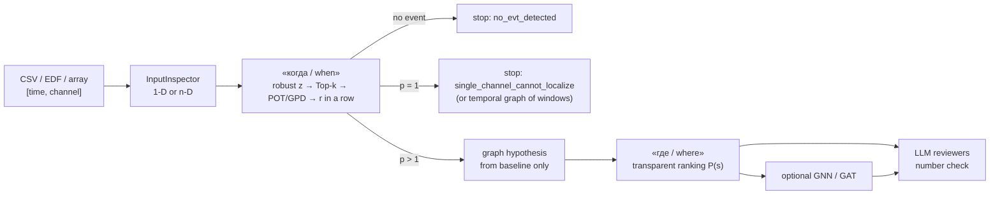

# Graph EVT Agent

**[Русский](#русский) · [English](#english) · [Математика / Math](#математика--math)**

Python-библиотека, которая отвечает на два вопроса об экстремальном событии в
многоканальном временном ряду: **«когда?»** (момент начала по теории
экстремальных значений, POT/GPD) и **«где?»** (распределение вероятности
узла-источника на графе зависимостей, построенном только по фону). Агенты LLM
(Mistral или любой свой клиент) рецензируют результат и пишут отчёт, но **не
меняют чисел**.

A Python library that answers two questions about an extreme event in a
multichannel time series: **"when?"** (onset time from extreme value theory,
POT/GPD) and **"where?"** (a probability distribution over source nodes on a
dependence graph learned from the background only). LLM agents (Mistral or any
client of your own) review the result and write a report, but **never change the
numbers**.

> Редкое наблюдение не обязательно патология, ребро графа не доказывает
> причинную связь, а первый измеривший отклонение датчик может не быть
> физическим источником.
> A rare observation is not necessarily a pathology, a graph edge is not a causal
> link, and the first sensor to register a deviation need not be the physical
> source.



Подробнее / More: [`docs/OVERVIEW.md`](docs/OVERVIEW.md) (обзор возможностей,
EN), [`docs/PIPELINE.md`](docs/PIPELINE.md) (конвейер и агенты, EN),
[`docs/STORY.md`](docs/STORY.md) (история использования, RU),
[`notebooks/`](notebooks) (исполненные ноутбуки 01–04).

---

## Русский

### Что умеет библиотека

| Задача | Где в коде | Что возвращает |
|---|---|---|
| Проверка и приведение входа | `InputInspector`, `load_timeseries` | `[время, канал]`, профиль 1-D / n-D |
| «Когда»: детекция по POT/GPD | `evt.detect`, `evt.find_events` | момент $\hat t$, порог, индикатор, все эпизоды записи |
| Гипотеза графа по фону | `GraphConfig`, `graph.build_graph` | матрица зависимости $D$, рёбра, диагностика |
| «Где»: прозрачное ранжирование | `localization.rank_sources` | $P(s)$ по узлам и признаки узлов |
| Одномерный ряд: граф окон | `TemporalGraphConfig`, `build_temporal_graph` | окна как узлы, взвешенные рёбра, контекст начала |
| Разметка эпизодов | `EpisodeLabeler` | manual / pseudo / abstained |
| Обучение GNN и GAT | `ProcessModelTrainer`, `GraphProcessModel` | модели на NumPy, кривые качества, Top-1 / MRR / NLL |
| Оценка набора случаев | `EvaluationOrchestrator` | hit / miss / early_alarm / false_alarm, ранги источника |
| Агенты-рецензенты | `agents.EVTAgentTeam` | отчёт, проверка чисел, вердикт и расхождение |
| Синтетика с известной истиной | `graph_evt_agent.synthetic` | ряды с известными $t^{*}$ и $s^{*}$ |

Зависимости ядра — только `numpy` и `scipy`. Python ≥ 3.10.

### Установка

```bash
git clone https://github.com/D2718281828nis/Graph-EVT-agent.git
cd Graph-EVT-agent
python -m venv .venv
source .venv/bin/activate
python -m pip install -e .            # ядро
python -m pip install -e '.[edf]'     # чтение EDF/EDF+/BDF (pyEDFlib)
python -m pip install -e '.[viz,progress]'  # графики и progress bar
python -m pip install -e '.[llm]'     # клиент Mistral
python -m pip install -e '.[dev]'     # всё для разработки; затем: pytest
```

### Быстрый старт: синтетика с известным ответом

Данные не нужны: генератор создаёт кольцо из 6 каналов, где в канале `ch2` в
момент 420 зарождается всплеск и расходится по соседям.

```python
from graph_evt_agent import EVTConfig, GraphConfig, GraphEVTPipeline
from graph_evt_agent.synthetic import make_propagation_episode

episode = make_propagation_episode(n_channels=6, source=2, seed=1)
pipeline = GraphEVTPipeline(
    EVTConfig(baseline_size=400, tail_quantile=0.95, alarm_probability=0.999,
              top_k=3, persistence=3),
    GraphConfig(method="partial", edge_rule="topk", top_k_edges=2),
)
run = pipeline.run_detailed(episode.as_input())

names = run.input_profile.channel_names
print("истина:", episode.event_time, names[episode.source])      # 420 ch2
print("когда:", run.detection.time_index)                         # 420
print("где:", names[run.ranking.source])                          # ch2
print("маршрут:", run.plan.route, "остановка:", run.plan.stop_reason)
```

Для одного канала (`make_univariate_episode`) тот же конвейер найдёт момент, но
вернёт `graph=None`, `ranking=None` и причину `single_channel_cannot_localize`:
по одному датчику источник не идентифицируем (см. [М2](#2-можно-ли-ответить-где--is-where-answerable)).

### Свои данные: CSV и EDF

```python
from graph_evt_agent import load_timeseries, TimeSeriesInput, InputConfig

source = load_timeseries("episode.csv")                         # wide CSV
source = load_timeseries("episode.csv", time_column="sample_time", delimiter=";")
source = load_timeseries("record.edf")                          # также .bdf
source = TimeSeriesInput(values=X, timestamps=t, channel_names=("A1", "A2", "A3"))
```

Принимаются также `list`/`numpy.ndarray` (1-D или 2-D), `dict[str, sequence]` и
pandas-подобные `DataFrame`. **Главное требование: первые `baseline_size`
отсчётов — чистый фон до события.** Порог, нормировка и граф строятся только по
нему.

**CSV (wide):** одна строка — один момент времени, один столбец — один канал.

```csv
timestamp,A1,A2,A3
0.000,12.1,8.0,-0.2
0.005,12.4,8.1,-0.1
```

1. Заголовки непустые и уникальные.
2. Столбец `timestamp`, `time`, `datetime` или `date_time` считается временем;
   другое имя передайте как `time_column=...`.
3. Время — число или ISO-8601, строго возрастает, без дублей, по умолчанию с
   постоянным шагом.
4. Остальные ячейки — числа с точкой; пустая ячейка — `NaN`, обработка по
   `InputConfig.missing` (`error` по умолчанию, `drop_rows`, `interpolate`).
5. Формат long (`timestamp,channel,value`) не поддерживается — переведите в wide.
6. После фона должен остаться хотя бы один отсчёт.

**EDF/EDF+/BDF** (через `pyEDFlib`): каждый сигнал — канал, `label` — имя.
Нужны одинаковая частота и длина всех каналов и отсутствие пропусков; скрытого
ресемплирования нет. Время — `sample / sampling_frequency`, в секундах.

Интерполяция (`missing="interpolate"`) смотрит по обе стороны пропуска; для
строго причинного сценария оставьте `missing="error"` и импутируйте заранее.

### Полный запуск и результат

```python
from graph_evt_agent import EVTConfig, GraphConfig, GraphEVTPipeline, InputConfig

pipeline = GraphEVTPipeline(
    EVTConfig(baseline_size=5_000, tail_quantile=0.95, alarm_probability=0.999,
              top_k=3, persistence=5),
    GraphConfig(method="ensemble", dfa_scales=(8, 16, 32, 64),
                wavelet_periods=(8.0, 16.0, 32.0), surrogate_count=199, random_state=42),
    input_config=InputConfig(missing="error"),
    verbose=True,                       # progress bar по шагам планировщика
)
run = pipeline.run_detailed("episode.csv")
```

| Поле `run` | Содержимое |
|---|---|
| `input_profile` | тип входа (1-D / n-D), имена каналов, частота, пропуски |
| `plan` | маршрут, стационарность фона, выполненные шаги, `stop_reason` |
| `detection` (`EVTDetection`) | `detected`, `time_index` $=\hat t$, `alarm_threshold`, `indicator`, медиана и масштаб фона |
| `graph` (`GraphResult`) | `adjacency`, `dependence` $=D$, `method`, `diagnostics` (α DFA, лаги, суррогатные пороги, …) |
| `ranking` (`SourceRanking`) | `node_ids` по убыванию, `probabilities`, `features` = `[peak, energy, latency, degree, neighbor]`, `source` |
| `process` | вероятности GNN и GAT и матрица внимания, если передана `process_model` |

Совместимый короткий вызов: `detection, graph, ranking = pipeline.run(source)`.

### Выбор гипотезы графа

Граф — **гипотеза** о том, по каким путям могло идти событие. Он строится
только по фону и замораживается до анализа события. Мера зависимости и правило
рёбер — параметры одного `GraphConfig`; формулы — в разделе
[М3](#3-гипотеза-графа--graph-hypothesis).

| `method` | Мера | Когда уместна |
|---|---|---|
| `ar` | корреляция AR-инноваций | стационарный фон |
| `dfa` | кросс-DFA: детрендированная ковариация + близость показателей α | нестационарный фон, тренды |
| `kuramoto` | фазовая синхронность по вейвлетам Морле + суррогатный тест | ритмические сигналы |
| `ensemble` | пересечение рёбер `dfa` и `kuramoto` | консервативный граф для нестационарного фона |
| `auto` | `ar` при стационарном фоне, иначе `ensemble` | быстрый старт; для науки выберите метод заранее |
| `corr` | $\lvert\mathrm{corr}\rvert$ при нулевом сдвиге | контроль, «наивный» граф |
| `partial` | частная корреляция | убрать рёбра через посредника (цепочка $a-b-c$) |
| `xcorr`, `pwxcorr` | лаговая и выбеленная (на AR-инновациях) кросс-корреляция | связи с задержкой |
| `granger` | условная причинность по Грейнджеру | задержки + отсев двухшаговых путей; нужен длинный фон |

| Параметр | Действие |
|---|---|
| `edge_rule="threshold"`, `edge_threshold` | ребро при $D_{ij}\ge$ порога (по умолчанию) |
| `edge_rule="topk"`, `top_k_edges` | $k$ сильнейших партнёров каждого узла, объединение |
| `surrogate_test=True` (`corr`, `xcorr`, `pwxcorr`) | ребро только выше квантиля циклических сдвигов каналов |
| `prune_indirect=True`, `lag_tolerance` (`xcorr`, `pwxcorr`) | убрать ребро, объяснимое двухшаговым путём с согласованной задержкой |
| `max_lag`, `lag_step`, `ridge` | окно лагов `xcorr`/`pwxcorr` и регрессия `granger` |

При значениях по умолчанию `ar`, `dfa`, `kuramoto`, `ensemble`, `auto` побитово
совпадают с прежней реализацией (72 из 72 сравнений). Недопустимые сочетания
отклоняются при создании `GraphConfig`.

### Одномерный ряд: граф окон

Для одного канала узлы — перекрывающиеся окна, а ответ на «где» становится
временным: какое окно содержит начало события.

```python
from graph_evt_agent import TemporalGraphConfig, build_temporal_graph

graph = build_temporal_graph(series, TemporalGraphConfig(
    baseline_size=400, window_size=32, stride=8,
    edge_method="wavelet",     # neighborhood | dfa | wavelet | ar
    prune="knn", prune_k=3,    # none | threshold | knn | mst | disparity
    context=("ar", "wavelet", "dfa"), ar_order=8,   # признаки «начала события»
))
print(graph.features.shape, graph.feature_names, graph.density)
```

Контекстные признаки смотрят на `max(context_horizons)` отсчётов вперёд, поэтому
оценка ретроспективная. Для обучения: `univariate_graph_episode(series, event_time, config)`
или `ProcessModelTrainer(...).train_1d(...)`.

### Разметка эпизодов, обучение GNN/GAT, оценка

```python
from graph_evt_agent import (
    EpisodeLabeler, EvaluationCase, EvaluationOrchestrator, GraphLearningConfig,
    ProcessModelTrainer,
)
from graph_evt_agent import visualization as viz

# 1) все эпизоды каждой записи → признаки узлов + граф фона + метка
labels = EpisodeLabeler(pipeline, verbose=True).label(
    {"rec1": source1, "rec2": source2},
    annotations={"rec1": [(12_340, "A3")]},   # ручные метки (момент, канал)
)
print(labels.summary())                        # manual / pseudo / abstained

# 2) GNN и GAT с разбиением по записям и кривыми качества
report = ProcessModelTrainer(GraphLearningConfig(epochs=300), verbose=True).train(labels)
viz.plot_training_report(report).savefig("training.png")
report.model.save("graph_process_model.npz")

# 3) оценка смешанного набора 1-D и n-D
trained = GraphEVTPipeline(evt_config, graph_config, process_model=report.model)
evaluation = EvaluationOrchestrator(trained, verbose=True).evaluate([
    EvaluationCase(test_nd, event_time=5_210, source="A3"),
    EvaluationCase(test_1d, event_time=7_020),
])
print(evaluation.summary())
```

Псевдометки лишь копируют прозрачный ранжировщик и явно помечаются; качество
оценивайте только по ручной разметке. `verbose=2` показывает вложенные этапы,
`progress_callback=fn` передаёт `ProgressEvent` в GUI или логгер.

### Агенты-рецензенты (Mistral или свой клиент)

```python
from graph_evt_agent import EVTConfig, GraphEVTPipeline
from graph_evt_agent.agents import EVTAgentTeam, MistralClient

team = EVTAgentTeam(
    pipeline=GraphEVTPipeline(EVTConfig(baseline_size=5_000)),
    client=MistralClient(model="mistral-small-latest"),
)
report = team.run("episode.csv", task="Найти вероятный первый контакт эпизода")
print(report.final_report)          # итог координатора
print(report.unverified_numbers)    # числа текста, которых нет в JSON-сводке
print(report.pipeline_verdict, report.agent_verdict, report.disagreement)
```

- Порядок ролей: вход → EVT → граф → локализация → координатор. Для n-D — пять
  вызовов API, для 1-D или без события — три (граф и локализация пропускаются).
- Агенты видят только ограниченную JSON-сводку, без сырых отсчётов;
  `report.result` (числа конвейера) они не меняют.
- Каждое число текста сверяется со сводкой (`verify_numbers`); при расхождении
  координатор один раз переписывает итог, остаток попадает в `unverified_numbers`.
- Координатор заканчивает JSON-вердиктом `{"event_detected": …, "source": …}`;
  он хранится рядом с вердиктом конвейера, `disagreement` показывает расхождение.
- Вместо Mistral подходит любой объект с методом `complete(system: str, user: str) -> str`.

**Ключ API.** Передавайте `MISTRAL_API_KEY` только через окружение или менеджер
секретов (`read -s MISTRAL_API_KEY; export MISTRAL_API_KEY`; в GitHub Actions —
`gh secret set MISTRAL_API_KEY` и `env: MISTRAL_API_KEY: ${{ secrets.MISTRAL_API_KEY }}`).
Не храните ключ в коде, данных, README, `.env.example` или Git; опубликованный
ключ отзовите. Библиотека не читает `.env` сама.

**HTTP 401/403** возникают до запуска агентов: проверьте, что в переменной
лежит значение действующего ключа (не имя секрета и не `replace_with_a_new_key`),
и перезапустите kernel. Клиент превращает их в `MistralAPIError` без ключа и
тела ответа. Ошибки соединения, `429` и `5xx` повторяются (`max_retries`, по
умолчанию 2).

### Корректный экспериментальный протокол

1. Разбивайте данные **по объектам и целым эпизодам** (пациент, двигатель,
   запись), а не по отсчётам — иначе качество завышено (см. [М8](#8-проверка--verification)).
2. Выбирайте фон, `top_k`, квантиль хвоста, `persistence` и метод графа только
   на обучающих данных; замораживайте их до единственного теста.
3. Проверяйте тренд, смену масштаба и качество аппроксимации хвоста
   (mean-residual-life, устойчивость параметров, QQ/PP).
4. Измеряйте частоту ложных тревог на заведомо нормальном участке, а не только
   по формуле.
5. Метрики: задержка детекции, ложные тревоги во времени, Top-1, Top-k, MRR,
   NLL, доверительные интервалы по независимым эпизодам.
6. Сравнивайте с базовыми моделями: самый ранний порог, самый большой пик, **без
   графа**, переставленный граф. GAT — только после этого.

### Ограничения

- Пропуски и бесконечности отклоняются; их обработка — часть заранее заданной
  предобработки.
- Порядок AR, масштабы DFA и полосы вейвлетов задаёт пользователь; выбирайте их
  на обучающих данных.
- Вероятности прозрачного ранжировщика не откалиброваны без отдельной
  валидационной выборки. Внимание GAT — не объяснение причинности.
- GNN/GAT полезны только при многих независимо размеченных эпизодах и проверке
  на отложенных записях.
- Медицинское или промышленное решение нельзя принимать только по выводу
  библиотеки.

---

## English

### What the library does

| Task | Code | Output |
|---|---|---|
| Input validation and coercion | `InputInspector`, `load_timeseries` | `[time, channel]` array, 1-D / n-D profile |
| "When": POT/GPD detection | `evt.detect`, `evt.find_events` | onset $\hat t$, threshold, indicator, all episodes of a recording |
| Graph hypothesis from the background | `GraphConfig`, `graph.build_graph` | dependence matrix $D$, edges, diagnostics |
| "Where": transparent ranking | `localization.rank_sources` | $P(s)$ over nodes and node features |
| Univariate series: graph of windows | `TemporalGraphConfig`, `build_temporal_graph` | windows as nodes, weighted edges, onset context |
| Episode labelling | `EpisodeLabeler` | manual / pseudo / abstained |
| GNN and GAT training | `ProcessModelTrainer`, `GraphProcessModel` | NumPy models, learning curves, Top-1 / MRR / NLL |
| Batch evaluation | `EvaluationOrchestrator` | hit / miss / early_alarm / false_alarm, source ranks |
| Reviewer agents | `agents.EVTAgentTeam` | report, number check, verdict and disagreement |
| Synthetic ground truth | `graph_evt_agent.synthetic` | series with known $t^{*}$ and $s^{*}$ |

The core depends only on `numpy` and `scipy`; Python ≥ 3.10.

### Installation

```bash
git clone https://github.com/D2718281828nis/Graph-EVT-agent.git
cd Graph-EVT-agent
python -m venv .venv && source .venv/bin/activate
python -m pip install -e .                    # core
python -m pip install -e '.[edf]'             # EDF/EDF+/BDF reader (pyEDFlib)
python -m pip install -e '.[viz,progress]'    # plots and progress bars
python -m pip install -e '.[llm]'             # Mistral client
python -m pip install -e '.[dev]'             # everything for development; then: pytest
```

### Quick start on synthetic data with a known answer

```python
from graph_evt_agent import EVTConfig, GraphConfig, GraphEVTPipeline
from graph_evt_agent.synthetic import make_propagation_episode

episode = make_propagation_episode(n_channels=6, source=2, seed=1)  # ring, burst in ch2 at t=420
pipeline = GraphEVTPipeline(
    EVTConfig(baseline_size=400, tail_quantile=0.95, alarm_probability=0.999,
              top_k=3, persistence=3),
    GraphConfig(method="partial", edge_rule="topk", top_k_edges=2),
)
run = pipeline.run_detailed(episode.as_input())
names = run.input_profile.channel_names
print("truth:", episode.event_time, names[episode.source])   # 420 ch2
print("when:", run.detection.time_index)                      # 420
print("where:", names[run.ranking.source])                    # ch2
print(run.plan.route, run.plan.stop_reason)                   # n-d None
```

With a single channel the same pipeline still finds the onset, but returns
`graph=None`, `ranking=None` and the stop reason `single_channel_cannot_localize`:
one sensor cannot identify the source (see [M2](#2-можно-ли-ответить-где--is-where-answerable)).

### Your own data

`load_timeseries` reads wide CSV (one row per time stamp, one column per channel,
a header row, a `timestamp`/`time`/`datetime`/`date_time` column or an explicit
`time_column=`) and EDF/EDF+/BDF (all signals at one sampling rate and length; no
hidden resampling). Arrays, `dict[str, sequence]`, pandas-like `DataFrame`s and
`TimeSeriesInput(values, timestamps, channel_names)` are accepted as well.
Missing values are an error by default (`InputConfig(missing="error" | "drop_rows" | "interpolate")`).
**The first `baseline_size` samples must be clean pre-event background**: the
normalisation, the EVT threshold and the graph are fitted on them only.

`pipeline.run_detailed(source)` returns a `PipelineResult` with `input_profile`,
`plan` (route, stationarity, completed actions, `stop_reason`), `detection`
(`time_index` $=\hat t$, `alarm_threshold`, `indicator`), `graph` (`adjacency`,
`dependence`, `method`, `diagnostics`), `ranking` (`node_ids`, `probabilities`,
`features`, `source`) and `process` (GNN/GAT output when a `process_model` is given).

### Choosing a graph hypothesis

The graph is a **hypothesis** about the paths along which an event can spread.
It is built from the background only and frozen before the event is analysed.
`method` ∈ `ar`, `dfa`, `kuramoto`, `ensemble`, `auto`, `corr`, `partial`,
`xcorr`, `pwxcorr`, `granger` selects the dependence measure; `edge_rule`
(`threshold` / `topk`), `surrogate_test`, `prune_indirect`, `max_lag`, `lag_step`
and `ridge` control the edges. The Russian table above summarises when each
measure fits; the formulas are in [M3](#3-гипотеза-графа--graph-hypothesis).
Prefer choosing the method on training data over `auto`.

### Univariate series: a graph of windows

For one channel the nodes are overlapping windows and "where" becomes "which
window contains the onset": `build_temporal_graph(series, TemporalGraphConfig(...))`
with `edge_method` ∈ `neighborhood`, `dfa`, `wavelet`, `ar`, pruning `prune` ∈
`none`, `threshold`, `knn`, `mst`, `disparity`, and optional onset-context
features `context=("ar", "wavelet", "dfa")`. Context looks
`max(context_horizons)` samples ahead, so it is retrospective.

### Labelling, GNN/GAT training, evaluation

`EpisodeLabeler(pipeline).label(recordings, annotations=...)` finds every
declustered episode, ranks its source and labels it **manual** (matches an
expert annotation), **pseudo** (confident heuristic) or **abstained**.
`ProcessModelTrainer(GraphLearningConfig(...)).train(labels)` trains the GNN and
GAT with a split by recording and records loss/accuracy curves.
`EvaluationOrchestrator(pipeline).evaluate([EvaluationCase(...), ...])` scores
mixed 1-D and n-D cases. See the Russian code example above and
[`docs/STORY.md`](docs/STORY.md). Pseudo-labels only copy the heuristic ranker;
report quality on manual labels only.

### Reviewer agents

`EVTAgentTeam(pipeline, client).run(source, task=...)` runs the roles input →
EVT → graph → localisation → coordinator (five API calls for n-D, three for 1-D
or no event). Agents see a bounded JSON summary without raw samples and never
modify `report.result`. Every number in their text is checked against that
summary (`verify_numbers`); unverified numbers trigger one rewrite and are then
listed in `report.unverified_numbers`. The coordinator's JSON verdict is stored
next to the pipeline's verdict, with `report.disagreement`. Any object with
`complete(system: str, user: str) -> str` can replace `MistralClient`.
Pass `MISTRAL_API_KEY` through the environment or a secrets manager only; never
commit it. HTTP 401/403 means the key value is wrong or revoked.

### Experimental protocol and limits

Split by object and whole episode, not by sample; fix the baseline, `top_k`, tail
quantile, persistence and graph method on training data; check the tail fit;
measure false alarms on a known-normal stretch; compare against no-graph and
permuted-graph baselines before training a GAT. Missing values are rejected,
heuristic probabilities are uncalibrated, GAT attention is not a causal
explanation, and no medical or industrial decision should rest on this library
alone.

---

## Математика / Math

Раздел следует § 2.18 диссертации и файлу `methods_and_harness.md`
(репозиторий [dissertation-calculations](https://github.com/D2718281828nis/dissertation-calculations)).
Формулы приведены в том виде, в каком они реализованы в коде; ссылки — на модули
пакета.

This section follows § 2.18 of the dissertation and `methods_and_harness.md`.
Formulas are given as implemented; references point to package modules.

### 0. Постановка «когда — где» / The "when–where" problem

Система — граф взаимодействий $G=(V,E)$ с метрикой кратчайших путей $d(\cdot,\cdot)$.
Наблюдаются элементы $O\subseteq V$, $\lvert O\rvert=p$, ряд
$\mathbf X_t=(X_{t,o})_{o\in O}$, $t=1,\dots,T$. В момент $t^{*}$ в элементе
$s^{*}\in V$ зарождается экстремальное событие и распространяется по $G$. По
ряду, фону $\{1,\dots,T_b\}$, $T_b<t^{*}$, и гипотезе о графе требуется оценить

```math
\hat t\ \ (\text{«когда» / "when"}),\qquad P(\hat s=v),\ v\in V\ \ (\text{«где» / "where"}).
```

**RU.** Две задачи решаются последовательно и разными средствами: «когда» —
статистикой хвоста одного агрегированного индикатора, «где» — сравнением
откликов узлов на графе. Всё, что настраивается (нормировка, порог, граф),
оценивается только по фону $T_b$ — это защищает от утечки события в модель.

**EN.** The two questions are solved in sequence by different tools: "when" by
tail statistics of one aggregate indicator, "where" by comparing node responses
on a graph. Everything that is fitted (normalisation, threshold, graph) is fitted
on the background $T_b$ only, so the event cannot leak into the model.

| Символ / Symbol | Смысл / Meaning | В коде / Code |
|---|---|---|
| $p$, $T_b$ | число каналов; длина фона / channels; background length | `baseline_size` |
| $I_t$ | агрегированный индикатор / aggregate indicator | `detection.indicator` |
| $k$ | число самых отклонившихся каналов / top-k channels | `top_k` |
| $u,\ q$ | порог хвоста и его квантиль / tail threshold and its quantile | `tail_quantile` |
| $\gamma$, $q_{\mathrm{EVT}}$ | уровень непревышения; порог тревоги / non-exceedance level; alarm threshold | `alarm_probability`, `alarm_threshold` |
| $r$ | превышений подряд / exceedances in a row | `persistence` |
| $\pi_0,\ \pi_1$ | вероятность превышения до и после $t^{*}$ / exceedance probability before and after $t^{*}$ | — |
| $D$, $A$ | матрица зависимости; смежность / dependence; adjacency | `graph.dependence`, `graph.adjacency` |

### 1. «Когда»: POT/GPD и правило устойчивости / "When": POT/GPD and persistence

**Робастная стандартизация** по фону (`evt.detect`):

```math
z_{t,j}=\frac{\lvert X_{t,j}-m_j\rvert}{\max\!\big(1{,}4826\,\mathrm{MAD}_j,\ \varepsilon\big)},\qquad
m_j=\operatorname{med}_{t\le T_b}X_{t,j},\quad \mathrm{MAD}_j=\operatorname{med}_{t\le T_b}\lvert X_{t,j}-m_j\rvert .
```

**Индикатор Top-k** — среднее $k$ самых больших отклонений в момент $t$:

```math
I_t=\frac1k\sum_{j\in\mathcal T_k(t)} z_{t,j}.
```

**Порог POT/GPD.** $u$ — квантиль $q$ индикатора на фоне; к превышениям
$I_t-u>0$ на фоне подгоняется обобщённое распределение Парето
$\mathrm{GPD}(\hat\xi,\hat\sigma)$. Порог тревоги — квантиль уровня $\gamma$
безусловного распределения:

```math
q_{\mathrm{EVT}}=u+G^{-1}_{\hat\xi,\hat\sigma}\!\Big(\frac{\gamma-q}{1-q}\Big)
=u+\frac{\hat\sigma}{\hat\xi}\Big[\Big(\frac{1-\gamma}{1-q}\Big)^{-\hat\xi}-1\Big].
```

Если превышений на фоне меньше пяти, берётся эмпирический квантиль $\gamma$.

**Правило устойчивости.** $B_t=\mathbb 1[I_t>q_{\mathrm{EVT}}]$. Тревога — конец
$\tau_r$ первой после фона серии из $r$ превышений подряд; оценка начала
$\hat t=\tau_r-r+1$ (код возвращает начало серии).

**Утверждение 2.18.1 (М1).** Если $B_t$ независимы с вероятностью $\pi$, среднее
число наблюдений до первой серии из $r$ превышений

```math
\mu_r(\pi)=\sum_{j=1}^{r}\pi^{-j}=\frac{1-\pi^{r}}{(1-\pi)\,\pi^{r}} .
```

| Следствие / Corollary | Формула / Formula |
|---|---|
| Ложные тревоги, $\pi_0=1-\gamma$ / false alarms | $\mathrm{ARL}_0=\mu_r(1-\gamma)\ \geqslant\ (1-\gamma)^{-r}$ |
| Смещение оценки начала / onset bias | $\mathbb E[\hat t-t^{*}]=\mu_r(\pi_1)-r=\sum_{j=1}^{r}(\pi_1^{-j}-1)$ |
| Запаздывание тревоги / alarm delay | $\mathbb E[\tau_r-t^{*}]=\mu_r(\pi_1)-1$ |
| Кластеры превышений, экстремальный индекс $\theta$ / clustering | $\mathrm{ARL}_0\approx[\theta\,\pi_0\,P(L\geqslant r)]^{-1}$ |
| Короткий фон, $\hat\pi_0=\pi_0(1+\delta)$ / short background | $\ln\mathrm{ARL}_0(\hat\pi_0)\approx\ln\mathrm{ARL}_0(\pi_0)-r\ln(1+\delta)$ |

**RU.** Каждое лишнее превышение в правиле умножает среднее время без ложной
тревоги примерно в $1/(1-\gamma)$ раз: при $\gamma=0{,}999$ и $r=3$ это около
$10^9$ окон. Цена — смещение начала: при $\pi_1=0{,}5$ оно 1, 4 и 11 наблюдений
для $r=1,2,3$. Формула предполагает независимые превышения и точно известный
порог; короткий фон и кластеры превышений уменьшают $\mathrm{ARL}_0$, поэтому
частоту ложных тревог нужно дополнительно измерять на нормальном участке.

**EN.** Each extra required exceedance multiplies the mean time to a false alarm
by about $1/(1-\gamma)$: with $\gamma=0.999$, $r=3$ that is about $10^9$ windows.
The price is onset bias: 1, 4 and 11 samples for $r=1,2,3$ at $\pi_1=0.5$. The
bound assumes independent exceedances and an exact threshold; a short background
and clustering lower $\mathrm{ARL}_0$, so measure false alarms on a known-normal
stretch as well.

**Все эпизоды записи** (`evt.find_events`): после начала эпизода детектор ждёт
рефрактерный период $\rho$ и возврата $I_t\le q_{\mathrm{EVT}}$, поэтому одно
длинное отклонение — один эпизод. / After an onset the detector waits $\rho$
samples and for $I_t$ to fall below the frozen threshold, so one long excursion
is one episode.

### 2. Можно ли ответить «где»? / Is "where" answerable?

**Определение 2.18.2.** $O$ **дважды разрешает** $V$, если для любых $u\neq v$
найдутся $o_1,o_2\in O$ с $d(u,o_1)-d(u,o_2)\neq d(v,o_1)-d(v,o_2)$.

**Теорема 2.18.1 (М2).** Пусть моменты прихода $a_o=t^{*}+d(s^{*},o)/c$ при
неизвестных $t^{*}$ и $s^{*}$. Источник однозначно восстанавливается по
$(a_o)_{o\in O}$ при любом $s^{*}$ тогда и только тогда, когда $O$ дважды
разрешает $V$.

| Следствие / Corollary | Вывод / Conclusion | В коде / Code |
|---|---|---|
| $p=1$ | источник неидентифицируем; «где» становится временны́м — окно начала / source is not identifiable; "where" becomes the onset window | `stop_reason="single_channel_cannot_localize"`; граф окон `build_temporal_graph` |
| $O=V$ | идентифицируем; ошибки дают шум, затухание и смещение тревоги / identifiable; errors come from noise, decay, alarm bias | n-D маршрут / route |
| $s^{*}\notin O$ | самый ранний наблюдаемый — ближайший к источнику, а не источник / earliest observed node is the nearest, not the source | — |

**Утверждение 2.18.3 (шум).** При $a_o=t^{*}+d(s^{*},o)/c+\varepsilon_o$,
$\varepsilon_o\sim\mathcal N(0,\sigma^2)$ и центрировании $P=I-\tfrac1p\mathbf 1\mathbf 1^{\top}$
(неизвестное $t^{*}$ уходит):

```math
\hat s=\arg\min_{v}\big\lVert P(\mathbf a-\mathbf d_v/c)\big\rVert^2,\qquad
P\big(\mathrm{RSS}(v)<\mathrm{RSS}(u)\big)=\Phi\!\left(-\frac{\lVert P(\mathbf d_u-\mathbf d_v)\rVert}{2c\sigma}\right).
```

**RU.** Две гипотезы-источника тем легче спутать, чем меньше различаются их
центрированные профили расстояний до датчиков: соседи по кольцу — типичная
ошибка. **EN.** Two candidate sources are confused more often the closer their
centred distance profiles are; ring neighbours are the typical error.

**Утверждение 2.18.4 ($p=1$, уровень случайности).** Для окон длины $w$ с шагом
$h$ и $N_w$ окон момент начала лежит в $\lceil w/h\rceil$ окнах, поэтому

```math
\pi_{\mathrm{rnd}}\approx\frac{\lceil w/h\rceil}{N_w},\qquad
\#\text{попаданий в } n \text{ записях}\ \sim\ \mathrm{Bin}(n,\pi_{\mathrm{rnd}})\ \text{при нулевой гипотезе / under } H_0 .
```

### 3. Гипотеза графа / Graph hypothesis

Рёбра строятся по матрице зависимости $D$, вычисленной **только на фоне**
$\mathbf X_{1:T_b}$ (`graph.build_graph`). Правило рёбер по умолчанию —
$A_{ij}=\mathbb 1[D_{ij}\ge\theta]$, симметризованное, с петлями $A_{ii}=1$.

| `method` | $D_{ij}$ |
|---|---|
| `ar` | $\lvert\operatorname{corr}(\varepsilon^{\mathrm{AR}}_i,\varepsilon^{\mathrm{AR}}_j)\rvert$, $\varepsilon^{\mathrm{AR}}$ — остатки AR(`ar_order`) каждого канала |
| `dfa` | $\tfrac12\,\overline{\lvert\operatorname{corr}(\varepsilon_i^{(n)},\varepsilon_j^{(n)})\rvert}^{\,n}+\tfrac12\,e^{-\lvert\alpha_i-\alpha_j\rvert}$ |
| `kuramoto` | $\Big\lvert\dfrac{1}{ST}\sum_{s}\sum_t e^{i(\phi_i(t,s)-\phi_j(t,s))}\Big\rvert$ (PLV), ребро только при $D_{ij}>$ квантиля суррогатов |
| `ensemble` | $\sqrt{D^{\mathrm{DFA}}_{ij}D^{\mathrm{K}}_{ij}}$; рёбра — пересечение $A^{\mathrm{DFA}}\wedge A^{\mathrm K}$ |
| `corr` | $\lvert\operatorname{corr}(x_i,x_j)\rvert$ |
| `partial` | $\lvert -P_{ij}/\sqrt{P_{ii}P_{jj}}\rvert$, $P=\operatorname{pinv}(\operatorname{corr}\mathbf X)$ |
| `xcorr` | $\max_{\lvert\ell\rvert\le L}\operatorname{corr}\big(x_i(t),x_j(t+\ell)\big)$, лаг пары — в `diagnostics["lag"]` |
| `pwxcorr` | то же на AR-инновациях (выбеливание Бокса — Дженкинса) |
| `granger` | $\max(G_{ij},G_{ji})$, $G_{im}=\ln\big(J_m^{(-i)}/J_m\big)$ |

**DFA** (`dfa`). Профиль $Y_j(t)=\sum_{\tau\le t}(x_j(\tau)-\bar x_j)$ режется на
окна масштаба $n$, в каждом удаляется линейный тренд, остаток $\varepsilon_j^{(n)}$:

```math
F_j(n)=\sqrt{\overline{\big(\varepsilon_j^{(n)}\big)^2}}\ \propto\ n^{\alpha_j}.
```

Ребро сочетает детрендированную взаимную корреляцию (по всем масштабам) и
близость показателей $\alpha$: оба канала одинаково «помнят» прошлое.

**Вейвлет–Курамото** (`kuramoto`). Фаза $\phi_j(t,s)=\arg W_j(t,s)$, где
$W_j(t,s)=\sum_\tau x_j(\tau)\,\psi_s^{*}(\tau-t)$, $\psi_s(\tau)=e^{2\pi i\tau/s}e^{-\tau^2/(2s^2)}$
(вейвлет Морле на периодах `wavelet_periods`). Значимость — 99 (по умолчанию)
суррогатов с независимым циклическим сдвигом фаз каждого канала; ребро, если
$D_{ij}\ge\theta$ и $D_{ij}$ выше квантиля `surrogate_quantile` суррогатов.
Диагностика — параметр порядка Курамото
$R_s=\overline{\big\lvert\tfrac1N\sum_j e^{i\phi_j(t,s)}\big\rvert}^{\,t}$.

**Условная причинность по Грейнджеру** (`granger`). Цель $m$ регрессируется (ridge)
на лаги $\ell\in\{\Delta,2\Delta,\dots,L\}$ **всех** каналов; $J_m$ — остаточная
сумма квадратов, $J_m^{(-i)}$ — то же без блока лагов канала $i$. Двухшаговый путь
$i\to j\to m$ объясняется прошлым $j$ и ребра $i-m$ не даёт — в отличие от
попарных мер.

**Правила рёбер / Edge rules.**

| Правило / Rule | Формула / Formula |
|---|---|
| `threshold` | $A_{ij}=\mathbb 1[D_{ij}\ge\theta]$ |
| `topk` | $A_{ij}=1$, если $j$ среди $k$ сильнейших партнёров $i$ или наоборот / if $j$ is among the $k$ strongest partners of $i$ or vice versa |
| `surrogate_test` | $A_{ij}\leftarrow A_{ij}\wedge \mathbb 1\big[D_{ij}>Q_{q}\{D_{ij}^{(b)}\}_{b=1}^{B}\big]$, $D^{(b)}$ — после циклических сдвигов каналов |
| `prune_indirect` | убрать $i-j$, если есть $k$: $D_{ik},D_{kj}>D_{ij}$ и $\big\lvert\,\lvert\ell_{ik}\rvert+\lvert\ell_{kj}\rvert-\lvert\ell_{ij}\rvert\,\big\rvert\le$ `lag_tolerance` |

**RU.** Граф — проверяемая гипотеза, а не факт: корреляция может соединить
каналы через общую внешнюю причину или двухшаговый путь, поэтому есть условные
меры (`partial`, `granger`) и суррогатный тест. Выбирайте меру до теста.
**EN.** The graph is a testable hypothesis, not a fact: correlation can link
channels through a common driver or a two-step path, hence the conditional
measures (`partial`, `granger`) and the surrogate test. Choose the measure before
testing.

### 4. «Где»: прозрачное ранжирование / "Where": transparent ranking

В окне отклика $[\hat t,\hat t+w)$, $w=12$ (`localization.rank_sources`),
для каждого узла $j$:

```math
\text{peak}_j=\max_t z_{t,j},\qquad
E_j=\overline{z_{t,j}^2},\qquad
\text{lat}_j=\min\{t-\hat t:\ z_{t,j}\ge\max(3,\tfrac12\text{peak}_j)\},
```

```math
\deg_j=\sum_i A_{ji}-1,\qquad
\text{nbr}_j=\frac{(A\,\text{peak})_j}{\sum_i A_{ji}},\qquad
P(s=j)=\operatorname{softmax}_j\!\big(\text{peak}_j+\sqrt{E_j}+0{,}15\,\text{nbr}_j-0{,}5\,\text{lat}_j\big).
```

$\hat s=\arg\max_j P(s=j)$.

**RU.** Источник — узел, который ответил **раньше и сильнее**, и чьи соседи по
графу тоже ответили. Веса фиксированы и не обучаются, поэтому ранжирование
прозрачно и служит базовой моделью для GNN/GAT; его вероятности не
откалиброваны. **EN.** The source is the node that responded **earlier and
stronger** and whose graph neighbours also responded. The weights are fixed, not
learned, so the ranking is transparent and is the baseline for GNN/GAT; its
probabilities are not calibrated.

### 5. Обучаемые GNN и GAT / Learned GNN and GAT

`learning.GraphProcessModel` — классификатор узла-источника на NumPy. Признаки
$X$ стандартизуются по обучающим эпизодам; $\tilde A$ — веса рёбер с петлями,
$\hat P=D^{-1}\tilde A$ — построчная нормировка.

```math
\text{GNN:}\quad H=\tanh\!\big([X\ \Vert\ \hat PX\ \Vert\ \hat P^{2}X]\,W+b\big),\qquad
\text{logit}_j=H_j\,v+c .
```

```math
\text{GAT:}\quad e_{ij}=\mathrm{LeakyReLU}_{0.2}\!\big(a_1^{\top}x_i+a_2^{\top}x_j\big)+\log\tilde A_{ij},\qquad
\alpha_{ij}=\operatorname{softmax}_{j:\tilde A_{ij}>0}e_{ij},\qquad
H=\tanh\!\big([X\ \Vert\ \alpha X]\,W+b\big).
```

Обе модели: $P(s=j)=\operatorname{softmax}_j(\text{logit}_j)$, функция потерь —
перекрёстная энтропия $-\log P(s^{*})$ с L2, оптимизатор Adam. Матрица $\alpha$ —
граф процесса конкретного эпизода; на взвешенном графе $\log\tilde A_{ij}$
работает как априорный вес.

**Утверждение 2.18.7 (вклад рёбер).** При $A=\varnothing$ ($\tilde A=I$) слой GNN
вырождается в $\sigma(XW)$, а GAT с $\mathcal N(i)=\{i\}$ даёт $\alpha_{ii}=1$.
Поэтому разность $\Delta_G=M(f_\theta(X,A))-M(f_\theta(X,\varnothing))$ изолирует
вклад рёбер. **EN.** With an empty graph both layers reduce to a per-node MLP, so
$\Delta_G$ isolates what the edges add; always report it.

### 6. Один канал: граф окон / One channel: a graph of windows

`temporal.build_temporal_graph`: узлы — окна длины $w$ с шагом $h$, признаки —
те же пять, что в § 4. Веса рёбер:

| `edge_method` | $w_{ab}$ |
|---|---|
| `neighborhood` | $\mathbb 1[\lvert a-b\rvert\le n_{\mathrm{nb}}]$, $n_{\mathrm{nb}}=$ `neighborhood` |
| `dfa` | кросс-DFA, окна в роли каналов / windows play the role of channels |
| `wavelet` | $\big(1-\sqrt{\mathrm{JSD}(p_a,p_b)}\big)\sqrt{E_{\min}/E_{\max}}$, $p$ — доли энергии уровней ДВП |
| `ar` | $\lvert\operatorname{corr}\rvert$ инноваций AR, подогнанной по фону |

Прореживание сохраняет веса: порог; $k$ сильнейших; максимальное остовное
дерево ∪ $k$ сильнейших (граф связен); фильтр несоразмерности (Serrano и др.,
2009) — ребро остаётся при

```math
p_{ab}=\Big(1-\frac{w_{ab}}{s_a}\Big)^{k_a-1}<\alpha,\qquad s_a=\sum_b w_{ab},\ k_a=\deg a .
```

**Контекст начала события** (`context`): начало события — точка разладки, поэтому
к окну $[t,t+H)$ добавляется его уровень относительно фона и контраст с
$[t-H,t)$ для $H\in$ `context_horizons`: энергия AR-инноваций
$\log\overline{\varepsilon^2}_{[t,t+H)}$, расстояние Йенсена — Шеннона
вейвлет-спектра до спектра фона, сдвиг показателя DFA. На синтетике с контекстом
`ar` центр найденного окна попадает в ±16 отсчётов от начала в 100 % записей, без
него — около 25 %.

### 7. Разметка эпизодов / Episode labelling

`labeling.EpisodeLabeler`: для каждого начала $t_k$ из `find_events`

```math
\text{origin}(t_k)=\begin{cases}
\text{manual}, & \lvert t_k-t_{\mathrm{ann}}\rvert\le\tau_{\mathrm{match}},\\
\text{pseudo}, & P_{(1)}\ge c_{\min}\ \text{и}\ P_{(1)}-P_{(2)}\ge\delta_{\min},\\
\text{abstained}, & \text{иначе / otherwise},
\end{cases}
```

где $P_{(1)}\ge P_{(2)}$ — две наибольшие вероятности ранжировщика; по умолчанию
$c_{\min}=0{,}5$, $\delta_{\min}=0{,}2$, $\rho=50$, $\tau_{\mathrm{match}}=25$.

**RU.** Модель, обученная только на псевдометках учителя $T$, в пределе
воспроизводит $T$, т. е. её точность равна точности $T$. Псевдометки годятся для
предобучения; качество — только по ручной разметке, разбиение — по записям.
**EN.** A model trained only on a teacher's pseudo-labels at best reproduces the
teacher. Use them for pre-training; measure quality on manual labels only, with a
split by recording.

### 8. Проверка / Verification

**Метрики локализации** (`training.ranking_metrics`), $\mathrm{rank}$ — место
истинного источника:

```math
\mathrm{Top}\text{-}1=\overline{\mathbb 1[\mathrm{rank}=1]},\quad
\mathrm{Top}\text{-}k=\overline{\mathbb 1[\mathrm{rank}\le k]},\quad
\mathrm{MRR}=\overline{1/\mathrm{rank}},\quad
\mathrm{NLL}=-\overline{\log P(s^{*})} .
```

**Исходы детекции** (`EvaluationOrchestrator`): hit (с задержкой $\hat t-t^{*}$),
early_alarm ($\hat t<t^{*}$), miss, false_alarm, correct_rejection.

**Завышение при случайном разбиении (М3, утв. 2.18.5–2.18.6).** Узлы одной группы
(ствол, двигатель, сектор, запись) размера $m$ имеют согласованные метки. При
случайном $K$-кратном разбиении хотя бы один сосед тестового узла оказывается в
обучении с вероятностью $1-K^{-(m-1)}$, и

```math
\mathbb E\,\hat R_{\mathrm{grp}}=R_{\mathrm{new}},\qquad
\Delta=\big(1-K^{-(m-1)}\big)(h-a_0),
```

где $h$ — согласие меток на рёбрах, $a_0$ — честное качество на новых группах.
**EN.** A random split leaks group neighbours into training and inflates the
metric by $\Delta$; split by group.

**Ценность графа (М4, опр. 2.18.3).** Граф полезен при группированном разбиении,
только если одновременно (а) $\bar\Delta_G>0$; (б) $\Delta_G>0$ на каждой
затравке; (в) односторонний $p<0{,}05$ по критерию Надо — Бенжио на фолдах:

```math
t=\frac{\bar d}{\sqrt{\left(\frac1J+\frac{n_{\mathrm{test}}}{n_{\mathrm{train}}}\right)s_d^2}},\qquad
d=M(G)-M(\varnothing),\qquad \mathrm{df}=J-1 .
```

Полная реализация правила — в `dissertation-calculations` (`graph_hypotheses.decision`);
здесь для этого служат `GraphProcessModel` с единичной матрицей смежности и
`ranking_metrics`.

**Структура графа.** Различие двух гипотез — индекс Жаккара
$J(E_1,E_2)=\lvert E_1\cap E_2\rvert/\lvert E_1\cup E_2\rvert$; восстановление
физических групп — $w(E)=\overline{\mathbb 1[g_i=g_j]}_{(i,j)\in E}$ против
случайного уровня $w_{\mathrm{rnd}}=\sum_g n_g(n_g-1)/\big(n(n-1)\big)$.

**RU.** Восстановление структуры и предсказательная ценность графа — разные
свойства, проверяйте и сообщайте их раздельно. **EN.** Recovering structure and
adding predictive value are different properties; test and report them
separately.

### 9. Числовая верность агентов / Numerical fidelity of agents

Конвейер выдаёт $y=f_\theta(X)$; агентный слой пишет текст $A=L(s(y))$ по
ограниченной сводке $s(y)$. $y$ вычисляется до $L$ и не является входом ни
одного численного шага, поэтому $f_\theta(X)$ не зависит от $L$ (проверено
тестом с подставным клиентом). Ответ принимается, если

```math
\forall a\in N(A)\ \ \exists e\in N(s(y)):\quad \lvert a-e\rvert\le\tfrac12\,10^{-d(a)}\ \ \text{или}\ \ \lvert a-100e\rvert\le\tfrac12\,10^{-d(a)},
```

где $N(\cdot)$ — числа текста, $d(a)$ — число знаков после запятой; целые меньше
10 не проверяются (`agents.verify_numbers`).
**EN.** Every number in the agents' text must equal a summary value rounded to
the written precision (or its percentage); otherwise the answer is rewritten once
and the remaining mismatches are flagged.

### 10. Что известно на проверке / What the checks show

| Проверка / Check | Результат / Result |
|---|---|
| Синтетика выше: кольцо 6 каналов, источник `ch2`, начало 420 / synthetic ring above | $\hat t=420$, $\hat s=$ `ch2` |
| Сеть с задержанными связями, `granger` / delayed-link network | рёбра восстановлены точно на 3 затравках; слабейшая истинная пара сильнее сильнейшей ложной более чем в 5 раз |
| Гауссова цепочка, `partial` против `corr` / Gaussian chain | `partial` находит ровно цепочку; `corr` соединяет все пары |
| Независимый шум, `surrogate_test` / independent noise | не больше 2 ложных рёбер из 10 пар |
| Обратная совместимость построителей / builder backward compatibility | 72 из 72 сравнений побитово равны |
| $p=1$, контекст `ar` / onset context | окно начала: 100 % с контекстом, ≈ 25 % без него |
| Три реальные системы (стерео-ЭЭГ, C-MAPSS, S&P 500), расчёт в `dissertation-calculations` / three real systems | графы хорошо восстанавливают физические группы (фазовая синхронность — 77 % рёбер внутри электродного ствола при 7,7 % у случайного графа), но ценность графа для ГНС по правилу (а)–(в) не подтверждена ни в одной из 34 проверок |

**RU.** Практический вывод: граф полезен как проверяемая модель структуры,
для локализации и интерпретации; заявлять, что он повышает точность ГНС, можно
только после правила (а)–(в) при группированном разбиении.
**EN.** In practice the graph is useful as a testable model of structure, for
localisation and interpretation; claim that it improves GNN accuracy only after
the (a)–(c) rule under a grouped split.

---

## Лицензия / License

См. / See [LICENSE](LICENSE).
